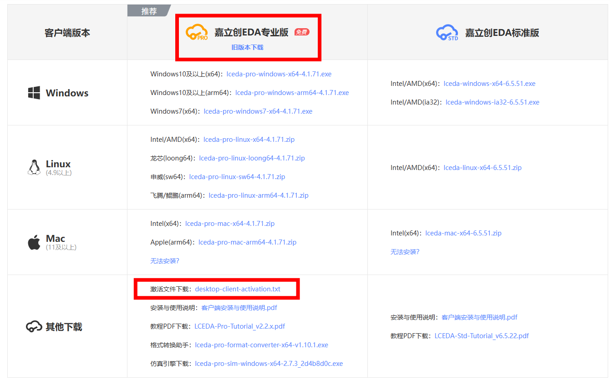

# PICO-Humanoid 工具链指南

## SolidWorks

- **安装包资源**
    - 百度网盘： https://pan.baidu.com/s/1GSeGaLDas8ZxkCIwwjWVZg?pwd=pico
    - 提取码：pico

- **MCP资源**
    - 项目地址：https://github.com/hjbaard/SolidWorks-MCP
    - 接入文档：[MCP-guide](MCP-guide.md#solidworks-mcp-接入与使用指南 "打开 MCP-guide.md")

## 嘉立创EDA

- **下载安装**
    - 下载地址：https://lceda.cn/page/download?src=index
    - 注意下载“专业版”及相应激活文件
        

- **MCP资源**
    - `jlceda-mcp` 为 `嘉立创EDA v4.1.60` 以上版本自带 
    - 接入文档：[MCP-guide](MCP-guide.md "打开 MCP-guide.md")

## 常用网站
